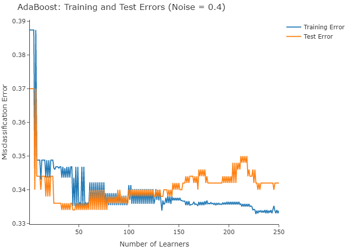
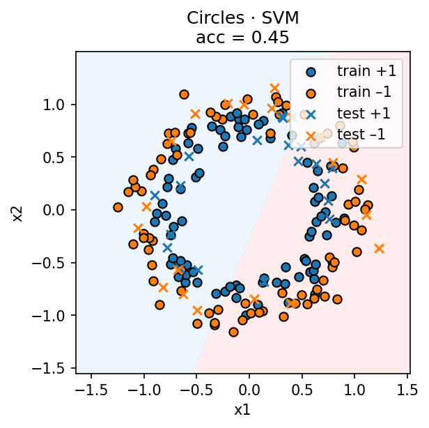

# Machine Learning Algorithms

Implementations and experiments spanning supervised learning, regularization, ensemble methods, and numerical optimization. The repository collects distinct machine-learning implementations and investigations into five self-contained areas, with their original algorithm code and selected experimental figures.

## Results at a glance

<table>
<tr>
<td width="50%"></td>
<td width="50%"></td>
</tr>
<tr><td align="center"><sub>AdaBoost training and test errors</sub></td><td align="center"><sub>Nonlinear classification boundary</sub></td></tr>
<tr>
<td></td>
<td></td>
</tr>
<tr><td align="center"><sub>Optimization convergence</sub></td><td align="center"><sub>Gaussian classifier comparison</sub></td></tr>
</table>

## Implementations

| Area | Algorithms and experiments | Code and results |
| --- | --- | --- |
| Regression and data preparation | Least squares, polynomial features, preprocessing, feature evaluation | [Regression](regression/README.md) |
| Linear and probabilistic classifiers | Perceptron, LDA, Gaussian Naive Bayes, decision-surface visualization | [Linear classifiers](linear-classifiers/README.md) |
| Classification boundaries | Linear SVM with varying regularization; SVM, KNN and decision trees on synthetic datasets | [SVM and model comparison](svm-and-model-comparison/README.md) |
| Ensemble learning and model selection | AdaBoost with decision stumps, k-fold cross-validation, Lasso and Ridge | [Boosting and regularization](boosting-and-regularization/README.md) |
| Gradient-based optimization | Gradient descent, fixed/exponential learning rates, L1/L2 objectives and logistic regression | [Gradient optimization](gradient-optimization/README.md) |

## Concepts and techniques

- **Linear algebra and optimization:** least-squares estimation, gradient-based training, convex loss functions, and regularization.
- **Statistical learning:** generative classifiers, margin-based classification, bias–variance considerations, and model selection.
- **Algorithm implementations:** iterative perceptron training, AdaBoost weight updates, decision stumps, and modular optimization components.
- **Experimental analysis:** train/test error curves, decision boundaries, cross-validation comparisons, and convergence diagnostics.
- **Python:** NumPy, pandas, Matplotlib, scikit-learn, Seaborn, and Plotly.

## Setup

Python 3 with the dependencies in [`requirements.txt`](requirements.txt):

```powershell
python -m venv .venv
.\.venv\Scripts\Activate.ps1
python -m pip install -r requirements.txt
```

The experiments use direct imports between files in their respective directories rather than a pip-installable package structure. Run commands from the relevant exercise directory. For example, the SVM investigation uses synthetic data and can be executed without an external dataset:

```powershell
cd svm-and-model-comparison
python solution.py
```

Some other experiments expect datasets from the original exercise environment, such as house prices, city temperatures, or `SAheart.data`. Those datasets are not included. The `README.md` in each directory identifies its input requirements. Several plotting scripts write output files to their working directory or a hard-coded relative path and may require adjustment for a different environment.

## Implementation notes

The regression, boosting, and optimization sections use the newer of two closely related exercise implementations. The earlier classification work is retained separately because it includes additional from-scratch estimators absent from the later exercise set.

Some base-estimator scaffolding and interfaces were provided for the course, including a file that attributes its design to Gilad Green and scikit-learn under BSD-3-Clause terms. Original attribution comments remain intact. The repository does not claim independent authorship of those provided components.

The original exercise reports, answer sheets, and datasets are not redistributed here. Results shown above are from the existing experiment outputs; they are not independently reproduced performance benchmarks.
