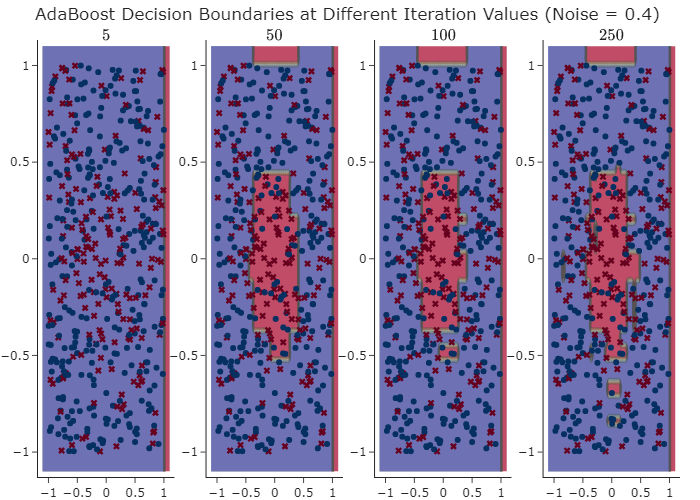
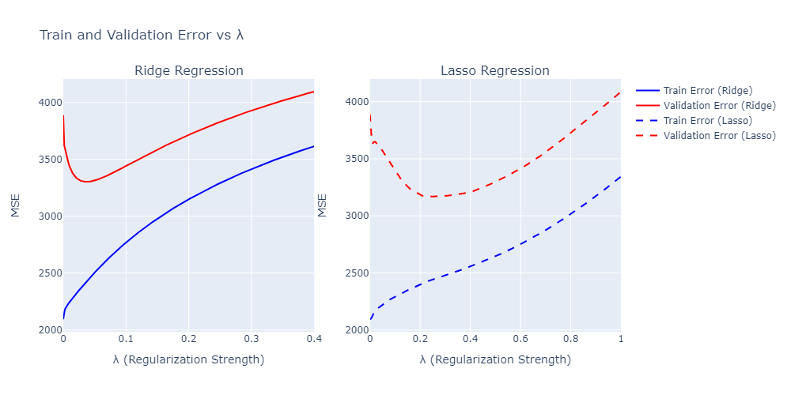

# Boosting, cross-validation, and regularization

This section combines an AdaBoost implementation with parameter selection experiments involving Ridge and Lasso regression.

## Algorithms

- [`adaboost.py`](adaboost.py): adaptive boosting with weighted weak learners.
- [`decision_stump.py`](decision_stump.py): decision-stump base classifier.
- [`adaboost_scenario.py`](adaboost_scenario.py): synthetic training and test experiments under label noise.
- [`cross_validate.py`](cross_validate.py): k-fold evaluation.
- [`estimators.py`](estimators.py): linear, Ridge and Lasso estimator wrappers using scikit-learn.
- [`perform_model_selection.py`](perform_model_selection.py): regularization parameter comparison on the diabetes dataset available through scikit-learn.

## Experiment outputs

**Requirements:** NumPy, pandas, scikit-learn, Plotly and Kaleido for image exports. Run scripts from this directory so local imports resolve. `perform_model_selection.py` uses a built-in scikit-learn dataset; the boosting script generates samples.
