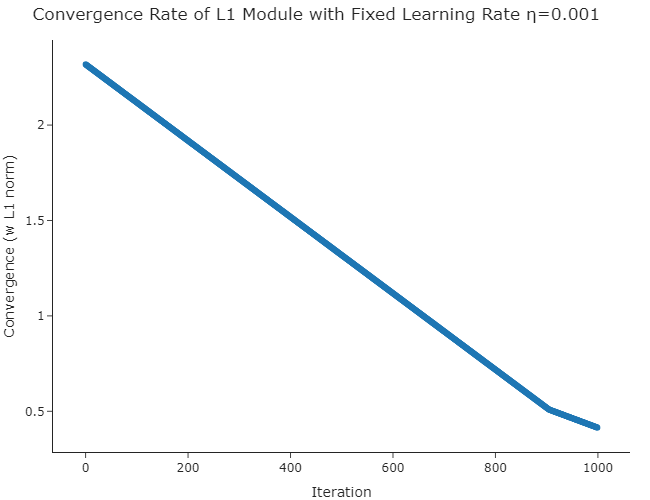
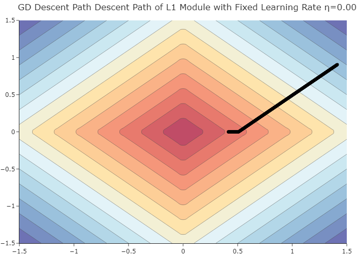

# Gradient descent and logistic regression

A modular gradient-based optimization implementation with alternative learning-rate policies, objective modules, and a logistic regression estimator.

## Implementation

| Component | File |
| --- | --- |
| Iterative gradient descent and stopping criteria | [`gradient_descent.py`](gradient_descent.py) |
| Fixed and exponential learning-rate schedules | [`learning_rate.py`](learning_rate.py) |
| L1, L2, logistic and regularized modules | [`modules.py`](modules.py) |
| Logistic regression estimator | [`logistic_regression.py`](logistic_regression.py) |
| Gradient trajectory and learning-rate experiments | [`gradient_descent_investigation.py`](gradient_descent_investigation.py) |
| Model and loss interfaces | [`base_module.py`](base_module.py), [`base_estimator.py`](base_estimator.py), [`loss_functions.py`](loss_functions.py) |

## Results

The implementation supports different returned solutions (`last`, `best`, `average`) and callback hooks for inspecting progress during optimization.

**Environment:** NumPy, scikit-learn, pandas and Plotly; Kaleido may be needed to export figures. Parts of `gradient_descent_investigation.py` expect the external `SAheart.data` dataset. The original module-level imports and exercise structure are preserved.
