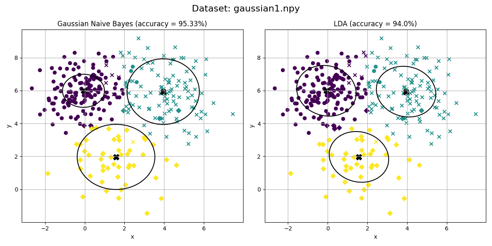
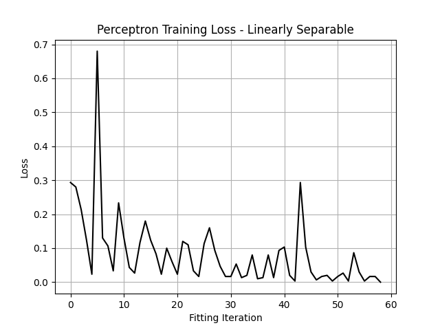

# Linear and probabilistic classifiers

Implementations of the Perceptron, Linear Discriminant Analysis (LDA), and Gaussian Naive Bayes. The evaluation script analyzes learning behavior on linearly separable data and decision boundaries for Gaussian classification problems.

**Implementation map**

| File | Responsibility |
| --- | --- |
| [`classifiers.py`](classifiers.py) | Perceptron, LDA, and Gaussian Naive Bayes estimators |
| [`classifiers_evaluation.py`](classifiers_evaluation.py) | Evaluation workflows and plots |
| [`loss_functions.py`](loss_functions.py) | Classification error and accuracy |
| [`base_estimator.py`](base_estimator.py) | Shared estimator interface, carrying the original attribution and license notice |
| [`utils.py`](utils.py) | Plotting and visualization helpers |

**Environment:** NumPy, pandas, Matplotlib, Plotly and supporting plotting utilities. Some evaluation paths expect original `.npy` classification datasets not included in this repository. The plotting helper contains course-provided and utility code; its original structure is retained.
