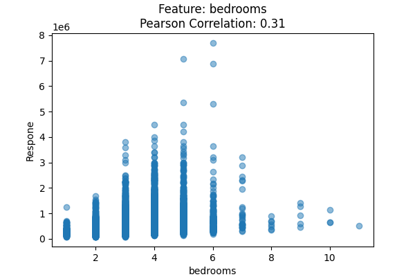

# Regression and feature engineering

The regression implementation covers ordinary least squares, polynomial fitting, feature preprocessing and exploratory analysis for house-price and temperature datasets.

**Core files**

- [`linear_regression.py`](linear_regression.py): least-squares estimator and prediction methods.
- [`polynomial_fitting.py`](polynomial_fitting.py): polynomial feature transformation and model fitting.
- [`house_price_prediction.py`](house_price_prediction.py): cleaning, categorical encoding, preprocessing, and feature examination.
- [`city_temperature_prediction.py`](city_temperature_prediction.py): temperature data loading and analysis.

**Requirements:** `numpy`, `pandas`, `matplotlib`; a matching house-price or temperature CSV is needed for the data-driven scripts. Original input files are not distributed. File paths and column names reflect those datasets.
