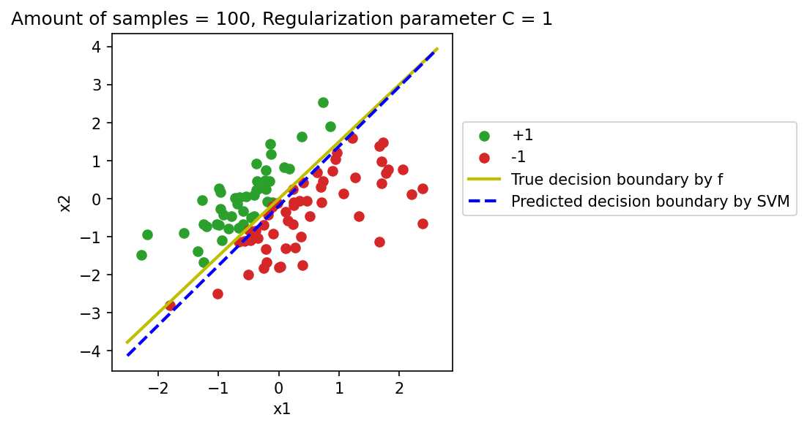

# Support Vector Machines and model comparison

A classification study using generated datasets, examining the effect of the SVM regularization parameter and comparing decision boundaries for different learning algorithms.

[`solution.py`](solution.py) includes a two-dimensional Gaussian sample generator, linear SVM fitting, plotting of learned versus reference separators, and comparisons involving SVM, K-nearest neighbors, and decision trees. The experiments also use synthetic moons, circles, and Gaussian configurations.

**Requirements:** NumPy, scikit-learn, Matplotlib and Seaborn. Experiments generate synthetic input data. Run from this directory with `python solution.py`; plotting and output behavior is controlled by the script's main block.
